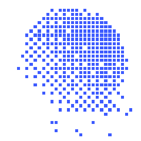
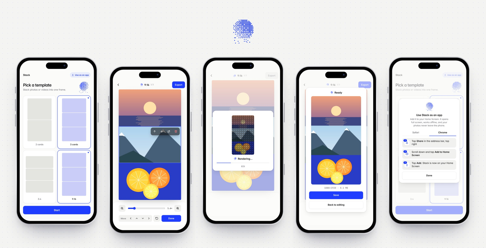
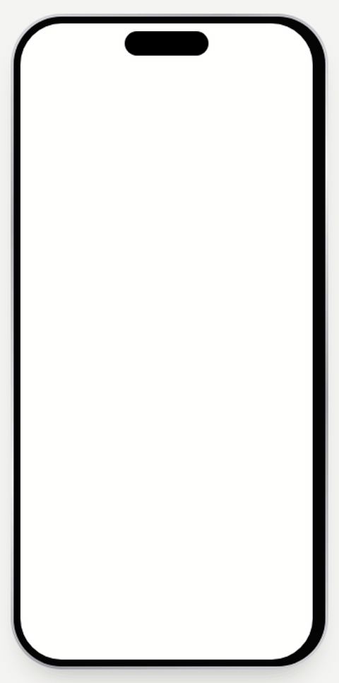
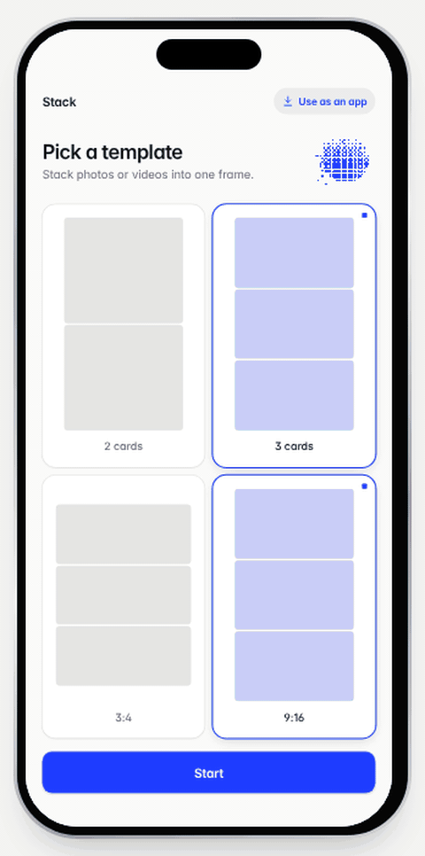
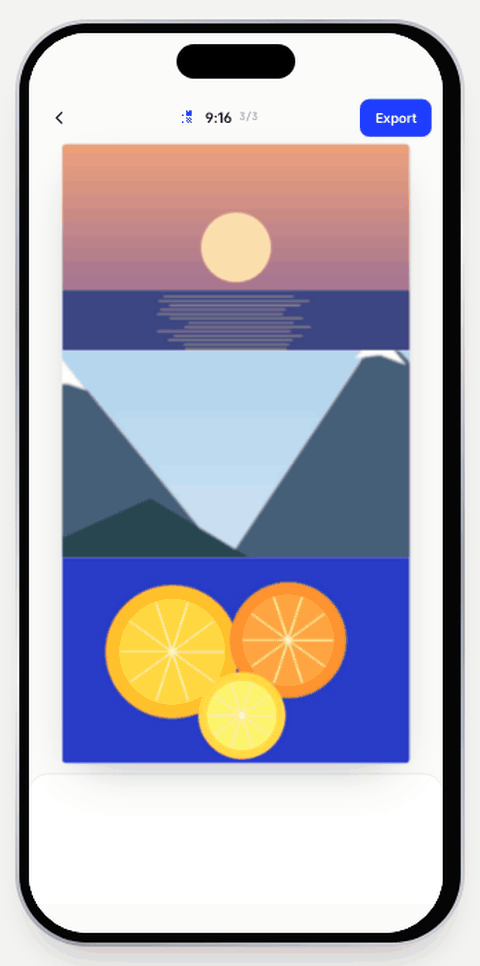

<p align="center">
  
</p>

<h1 align="center">Stack</h1>

<p align="center">
  Stack 2 or 3 photos or videos into one 9:16 or 3:4 frame, and export it at full quality.<br>
  Everything happens on your phone. Nothing is uploaded.
</p>

<p align="center">
  <a href="https://albsramos.github.io/stack-collage/"><b>Open Stack →</b></a>
</p>

<p align="center">
  
</p>

---

## How it feels

<table>
  <tr>
    <td align="center" width="33%"></td>
    <td align="center" width="33%"></td>
    <td align="center" width="33%"></td>
  </tr>
  <tr>
    <td valign="top"><b>Pick a template.</b> Choose 2 or 3 cards and a 9:16 or 3:4 frame. The orb forms itself from dots, follows your finger, and reacts differently every time you tap.</td>
    <td valign="top"><b>Fill it.</b> Tap a slot or add several at once. Drag to reposition, pinch to zoom, and reorder or swap any slot. Zoom shows its exact level and snaps back to 1×.</td>
    <td valign="top"><b>Export.</b> Your collage assembles itself dot by dot while it renders, then the orb pulses when it's ready. Save goes straight to the share sheet.</td>
  </tr>
</table>

## The orb

The logo is a lit sphere drawn as an [ordered dither](https://en.wikipedia.org/wiki/Ordered_dithering): an 8×8 Bayer matrix decides which squares light up, so the side facing the light is solid and the shadow side breaks into loose specks. It's drawn live on a canvas, so it can move:

| | |
|---|---|
| **Resting** | the light sways and a few specks twinkle |
| **Busy** | the light circles the sphere and the specks orbit it |
| **Progress** | the sphere fills in solid as an export runs |
| **Reacting** | a spin either way, a flick of light, a pulse, a burst of dust, or a re-form, picked at random |

Every change eases from the last one, so fast taps blend instead of jittering. The orb stops drawing when it's off screen and holds still under *Reduce Motion*. The home-screen icons are generated from the same code (`npm run icons`).

## Put it on your Home Screen

Stack is a web app you can install. It opens full screen, works offline, and keeps everything on the device. The app walks you through it (**Use as an app**, under Start), but in short:

- **iPhone, Safari:** Share → **Add to Home Screen** → Add
- **iPhone, Chrome:** Share in the address bar → **Add to Home Screen** → Add
- **Android, Chrome:** ⋮ menu → **Install app**

## Export quality

| | |
|---|---|
| Photos only | JPEG (quality 0.95) at 1080 wide, or 2160 wide with **High quality** |
| Any video | H.264 MP4, 30 fps, ~16 Mbps at 1080×1920 (~45 Mbps at 2×), AAC audio |

- Video is encoded frame by frame with WebCodecs via [Mediabunny](https://mediabunny.dev). There's no screen recording, so no dropped frames.
- Each video is decoded straight to the size it's drawn at, so there's no blurry double scaling.
- The output is as long as the longest clip, up to 60 s. Shorter clips loop.
- The MP4 is written to the browser's private file storage (OPFS) as it's encoded, not held in memory, so long 2× exports don't get the tab killed on iPhone. It's deleted when you close the result. Browsers without OPFS write streams (Safari before 26) fall back to memory.
- **Sound:** pick which video's audio to keep, or turn it off. If the browser can't encode AAC natively, a WASM AAC encoder is loaded on demand.

## Develop

```bash
npm install
npm run dev      # http://localhost:5173, also on your LAN for testing on a phone
npm run build
npm run icons    # regenerate public/icons from the orb
```

Built with Vite, React and TypeScript, `vite-plugin-pwa` for offline and install, and `mediabunny` for video decode and encode.

| File | What's in it |
|---|---|
| `src/App.tsx` | screens, editor, gestures, install guide |
| `src/layout.ts` | format sizes, slot geometry, pan and zoom math, shared by preview and export so the preview is exact |
| `src/media.ts` | loading photos and videos (dimensions, rotation, duration, audio) |
| `src/exporter.ts` | canvas rendering, MP4 encoding, save and share |
| `src/orb.ts` | the orb's drawing code: dither, light, dust |
| `src/Orb.tsx` | the live orb: animation, reactions, intro, finger tracking |
| `src/Previews.tsx` | the collage snapshot, the dot-by-dot export reveal, the empty-slot dot field |
| `src/styles.css` | design tokens (light and dark) and all styles |

## Deploy

Pushing to `main` builds the app and publishes it to the `gh-pages` branch (`.github/workflows/deploy.yml`), served at https://albsramos.github.io/stack-collage/.

## Requirements and limits

- Video export needs WebCodecs: Safari 17+ (iOS 17+), Chrome or Edge 94+.
- iPhone HEVC and Dolby Vision clips decode where the browser supports HEVC. Safari does; desktop Chrome depends on the hardware.
- When you pick several photos on iPhone, iOS shows its own spinner while it prepares the files. Stack can't replace that one; its own loader takes over once the picker closes.
