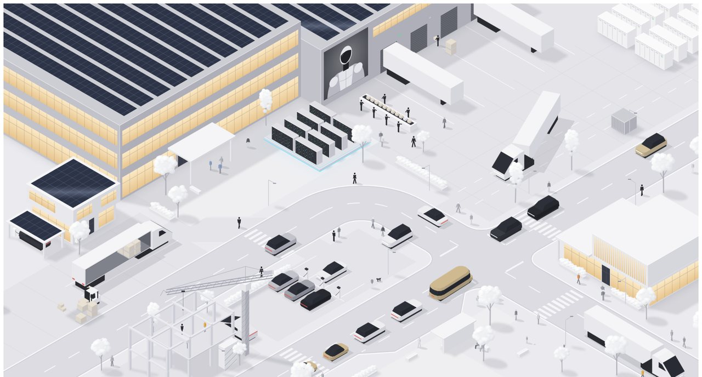
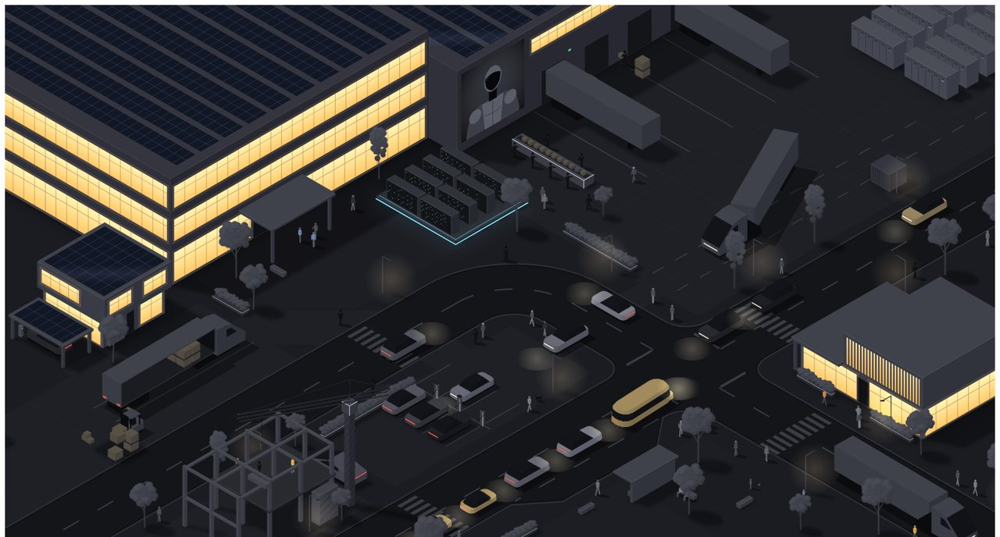

# living-city

A self-running isometric city for React, in a soft white-clay style. Nothing to configure and no text: drop it in and
it plays.



- **Traffic**: cars, SUVs, an angular pickup, two-seat robotaxis and a robovan drive a small road network. They stop
  at an invisible signal at the junction and give way to people already on the zebra crossings.
- **Truck yard**: semis turn in off the avenue and wait at the gate until the yard is clear. Each one drives down the
  yard lane past its dock, then backs in with the trailer swinging round. It loads under a green dock lamp, then pulls
  out and leaves by the street.
- **Loading bay**: a semi pulls into the bay beside the factory and rolls up its curtain side. A forklift and two
  humanoid robots fill it pallet by pallet, then it closes up and drives off across the scene.
- **Robots**: humanoid robots work a conveyor bench by the docks, carry boxes between the docked trailers, patrol the
  battery yard, work on the construction slab and walk the streets with everyone else.
- **Charging**: cars nose into the chargers, charge (with a pulsing light and cable), back out and leave.
- **Robotaxi stop**: pods and the van pull into the bay, open their doors, let people off, pick people up and go.
- **Construction**: a tower crane swings between the material pile and the slab while workers move around.
- **The home beside the loading bay**: solar roof, wall batteries with breathing status lights, and a carport where
  the car is on its charger.
- **Ambient detail**: walkers on a walkway network, people chatting, sitting on a bench or playing ball in the park,
  a dog on a walk, trees swaying, glints sweeping across solar roofs, blinking server racks, a breathing AI-compute
  glow and pulsing battery status lights.

There is a light theme and a night theme, and by default the scene matches the page it sits on (see *Dark mode*). Everything is drawn on one `<canvas>`, and the only dependency is React.



## Use it

```tsx
import { LivingCity } from 'living-city';

export function Hero() {
  return <LivingCity style={{ borderRadius: 24 }} />;
}
```

By default the component is as wide as its container and keeps the scene's own aspect ratio (about 1.86 : 1). Give
it a height, or put it in a sized box, and it fills that instead, cropping the edges (`fit="cover"`) or letterboxing
(`fit="contain"`):

```tsx
<div style={{ height: '70vh' }}>
  <LivingCity style={{ height: '100%' }} density={0.8} />
</div>
```

### Props

| Prop | Default | |
|---|---|---|
| `theme` | `'auto'` | `'auto'` matches the page around it (see *Dark mode*). `'light'` or `'dark'` (night) fixes one look |
| `speed` | `1` | Simulation speed. `0.5` is calm, `2` is busy |
| `density` | `1` | How many people and cars, from `0.3` to `1.5` |
| `seed` | `7` | Changes who walks where and which cars appear |
| `fit` | `'cover'` | `'cover'` fills the box and crops the edges. `'contain'` shows the whole scene |
| `focus` | `[0.5, 0.5]` | When `cover` crops, which part stays in view (`[0, 0]` is top left) |
| `zoom` | `1` | Extra zoom on top of the fit |
| `paused` | `false` | Freeze on the current frame |
| `maxDpr` | `2` | Cap on the device pixel ratio. Lower it to trade sharpness for speed |
| `respectReducedMotion` | `true` | Hold still when the visitor has asked for reduced motion |
| `label` | none | Accessible description. Without it the scene is treated as decorative (`aria-hidden`) |
| `className`, `style` | none | Applied to the wrapper `div` |

### Dark mode

With `theme="auto"` (the default) the scene takes the theme of the page around it, checking these in order:

1. A `data-theme` attribute on the nearest ancestor that has one, set to `"dark"` or `"light"`. Bootstrap's
   `data-bs-theme`, `data-color-scheme`, `data-mode` and `data-mantine-color-scheme` count too.
2. A `dark` or `light` class on `<html>` or `<body>`, which is what Tailwind's class strategy and next-themes set.
3. The visitor's system setting (`prefers-color-scheme`).

It watches those attributes, classes and the system setting, so a theme toggle on your site switches the scene as
well. The outgoing frame dissolves into the new one over about half a second. Before the first frame, the box shows
the theme's ground colour, so it doesn't flash white in a dark layout.

The same logic is exported as `resolveTheme(element)` and `watchTheme(element, onChange)` if you drive the engine
yourself.

### Behaviour worth knowing

- The animation stops while the component is scrolled out of view, and when the tab is hidden.
- Static scenery is rendered once per size into cached bitmaps, so a frame mostly stamps images and draws the
  moving parts. Resizing re-renders those caches.
- On mount, the scene runs about 40 simulated seconds in the background, so the first frame is already busy rather
  than empty.
- It is safe for server rendering: nothing touches `window` or `document` until it mounts.

### Without React

The engine is framework-free:

```ts
import { Scene } from 'living-city';

const scene = new Scene(canvas, { theme: 'dark', density: 0.8 });
scene.resize(canvas.clientWidth, canvas.clientHeight); // CSS pixels; call again when the size changes
// scene.set({ paused: true }) · scene.setVisible(false) · scene.destroy()
```

## Install

This package lives in `packages/living-city` and isn't on npm yet. Any of these work:

- **From this repository:** `npm install <path-to>/packages/living-city`. This runs nothing on install; build it first
  with `npm install && npm run build` inside the folder.
- **As a tarball:** `npm run build && npm pack`, then `npm install living-city-0.1.0.tgz` in your app.
- **Inside your own component library:** copy `src/` into it. It is plain TypeScript and React with no other imports.
- **Publish it:** rename it in `package.json` if you like (for example `@your-scope/living-city`), then run
  `npm publish`. The build produces ESM, CommonJS and type declarations in `dist/`.

React 17 or newer is a peer dependency.

## Develop

```sh
npm install
npm run dev        # demo page with theme, speed and density controls
npm run build      # library build into dist/
npm run typecheck
npm run build:artifact   # artifact-dist/living-city.html: a self-contained demo page (React from cdnjs)
```

The demo has two extra views: `?gallery` shows every vehicle at eight headings, and `?debug` exposes the scene as
`window.scene` for poking at the simulation.

### How it works

- `engine/core.ts`: projection (true isometric: X = (x − y)·cos 30°, Y = (x + y)/2 − z) and matte materials that
  shade each face from one key light.
- `engine/sort.ts`: painter's order. Every drawable has a world bounding box. Pairs that overlap on screen are
  ordered by the axis that separates them, and a depth-first walk gives the draw order.
- `engine/vehicles.ts`: small convex meshes, and a traffic model. Lanes are filleted paths. A semi's trailer
  follows its tractor with a hitch model going forward. When reversing, it replays a recorded forward pull-out
  backwards, which keeps the swing physically right. Each vehicle brakes for anything on the stretch of road it
  is about to drive. Junctions and crosswalks are zones it reserves in advance: first come, first served, with an
  actuated signal at the junction.
- `engine/walkers.ts`: people and robots, with a walk cycle and a walkway graph to wander.
- `engine/activities.ts`: the scripted scenes (truck yard, loading bay, charging lot, robotaxi stop, crane,
  workbench, park).
- `engine/world.ts`: the layout: ground plan, buildings, props, routes and walkways.
- `engine/scene.ts`: camera fit, the cached ground layer with baked soft shadows, bitmap caching and the frame loop.

The scene uses no logos, wordmarks or text.
